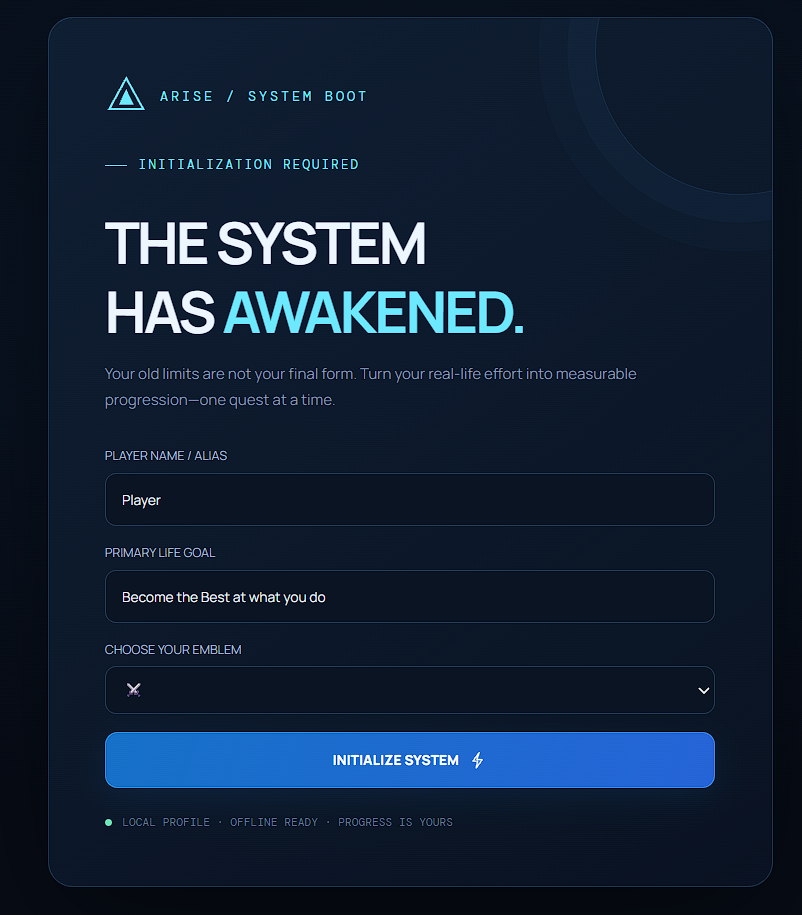
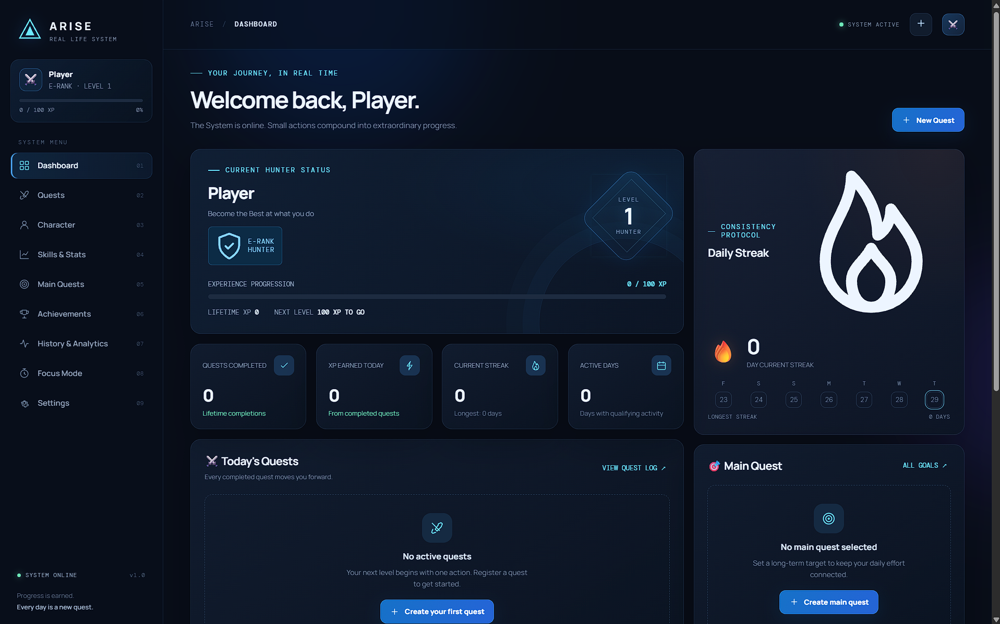
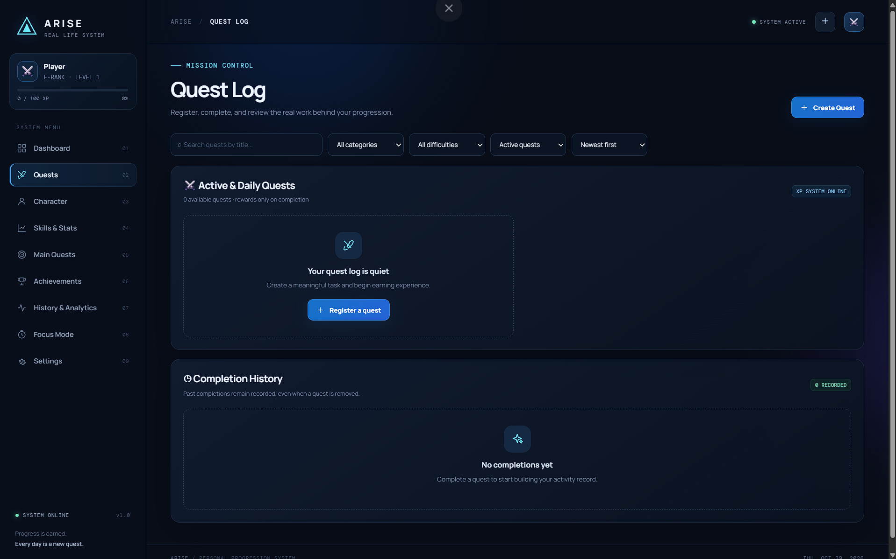
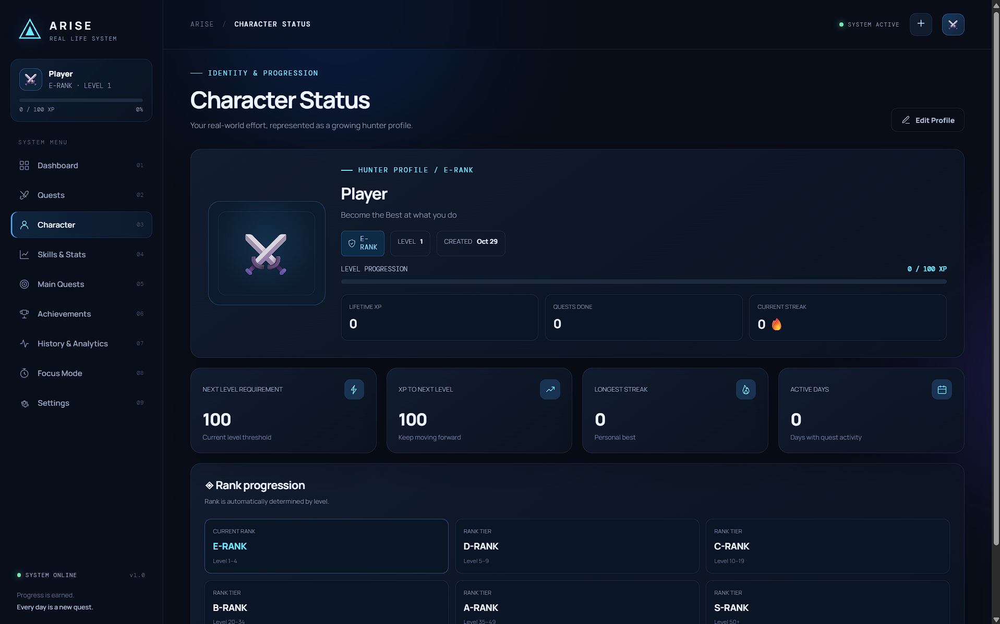

# ARISE — Real-Life RPG Progression System

> **Turn your real-life goals into quests. Earn XP, build streaks, level up, and track your progress.**

ARISE is a personal productivity and self-improvement dashboard inspired by role-playing games (RPGs). It helps you organize daily habits, short-term tasks, and long-term goals in one interactive interface.

## ✨ Features

- **Character profile** — create a personal player profile and choose an avatar.
- **XP and leveling** — earn experience points by completing quests and progress through levels and ranks.
- **Quest management** — create, edit, complete, and organize tasks.
- **Main quests** — keep long-term goals visible and track your bigger objectives.
- **Skills and stats** — monitor personal attributes and development.
- **Streaks and achievements** — encourage consistency and celebrate milestones.
- **History and analytics** — review activity and progress over time.
- **Focus mode** — use a built-in timer for focused work sessions.
- **Icon-enhanced interface** — custom SVG icons and avatar options support the futuristic RPG-inspired design.
- **Local persistence** — your app data is stored in your browser using `localStorage`.
- **Data portability** — settings include options to export and import data as JSON.
- **Responsive layout** — designed to adapt to desktop and smaller screens.

## 🧰 Built With

- HTML5
- CSS3
- Vanilla JavaScript
- Browser `localStorage`

No framework, package manager, or build step is required.

## 🌐 Live Demo

🔗 **Try the application here:**

**https://arise-rajdev.vercel.app/**

> Experience the app directly in your browser—no installation required.
---
## 📸 Preview






---

## 📁 Project Structure

```text
ARISE/
├── index.html   # App structure and page shell
├── style.css    # Layout, theme, responsive styles, and visual effects
├── script.js    # App behavior, quest logic, progression, and local data
└── README.md    # Project documentation
```

## 🕹️ How to Use

1. Open ARISE in your browser.
2. Set up your character profile.
3. Add daily tasks, habits, or quests.
4. Add your longer-term objectives under **Main Quests**.
5. Complete quests to earn XP and build consistency.
6. Check **Skills & Stats**, **Achievements**, and **History & Analytics** to review your progress.
7. Use **Focus Mode** for a dedicated work session.
8. Use **Settings** to manage app preferences and export or import your data.

## 💾 Data and Privacy

ARISE stores its app data in the browser's `localStorage`. Data is generally limited to the browser and origin where the app is running; it is not automatically synchronized between devices.

- Clearing browser site data may erase your saved progress.
- Opening the app in a different browser or on another device will not automatically bring your data with it.
- Use the JSON export option in Settings to keep a backup, and import it when needed.
- Only import JSON data from a source you trust.

## 🛠️ Customization

You can customize the project by editing:

- `style.css` to change colors, spacing, typography, layout, and visual effects.
- `index.html` to adjust the app shell and navigation.
- `script.js` to modify quests, XP rules, progression, achievements, and other interactions.

After making changes, refresh the browser to see the updates.

## ⚠️ Current Scope

ARISE is a front-end personal productivity project. It does not require a server or user account. Because data is stored locally, it does not currently provide built-in cloud synchronization or multi-device collaboration.

Some advanced recurring-habit and analytics workflows may be limited, so review the behavior in the app before relying on it for detailed long-term reporting.

## 🗺️ Possible Future Improvements

- Cloud backup and synchronization
- Recurring quest scheduling
- More detailed habit and streak analytics
- Customizable XP and rank rules
- Charts and weekly/monthly reports
- Optional reminders and notifications
- Automated tests and accessibility refinements

## 🤝 Contributing

Ideas and improvements are welcome. A simple workflow for contributing:

1. Fork or copy the project.
2. Create a branch for your change.
3. Make and test your update in a browser.
4. Keep the code readable and preserve existing behavior.
5. Submit a pull request or share your proposed changes.

---

**ARISE — Every day is a new quest.**
